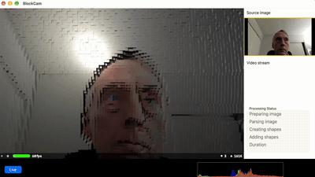
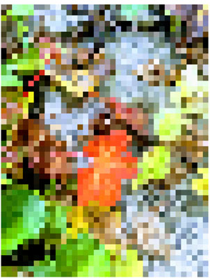
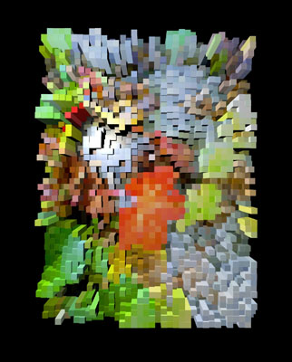
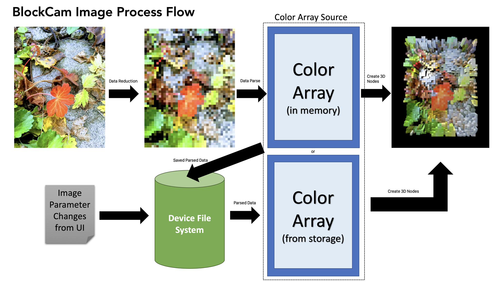
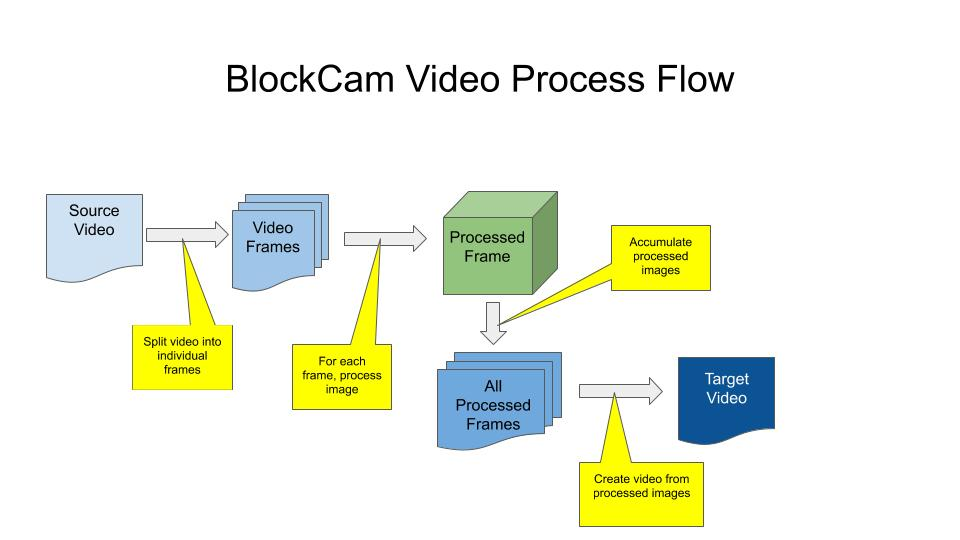

# BlockCam
Stuart Rankin\
2019 - 2026

**3D Block Camera**

BlockCam is a camera program for macOS (with an iOS/iPadOS parallel program) that takes images via AVFoundation and then converts those images into simple 3D scenes. The scenes may be rotated and scaled by the user, and saved as a flat image.

This is the desktop version of BlockCam. A mobile version was created in parallel.

## Live View
BlockCam supports real-time input from attached cameras. The current frame rate is at least 15 frames/second.

## Versioning

Versioning for BlockCam is maintained in the `Versioning.swift` file and is automatically updated with each build as a pre-build script step. The updating includes build IDs, build numbers, times and dates, but version numbers must currently be updated by hand. The current build string below is also maintained by the same mechanism.

The versioning program does not currently update the BlockCam project file's version numbers.

Most recent build: **Version 0.9 Alpha, Build 3294, Build date: 22 October 2026, 11:20am**

> See [VersionUpdater](https://github.com/sjrankin/VersionUpdater) repository on GitHub for information on how versions and builds are updated.

### Note (22 October 2026)
The instance of the version updater for BlockCam relies on Intel architecture. I temporarily disabled the script as it is not critical for the app.

## Privacy

BlockCam is designed to contain user-supplied information as much as possible. Any time user-identifiable information is used, BlockCam will ask for it explicitly. By design, BlockCam does not collect *any* user-identifiable information by default; the user *must* take active steps to allow collection of this type of information.

|Identifiable Information|Use|Storage|
|:--|:--|:--|
|User Name|The user's name (entered by the user) to be stored in processed image metadata.|Stored in `UserDefaults`.|
|User Copyright|The user's copyright string (entered by the user) to be stored in processed image metadata.|Stored in `UserDefaults`.|

## Program Flow

When the user instantiates BlockCam, it opens in live view mode (showing the view of the camera on the main screen). The user has the option of choosing one of three modes:

1. **Live View Mode** This is the default mode and allows the user to take pictures of whatever the program shows. Once the picture is taken, it is processed then displayed in the view.
2. **Album Mode** This mode allows the user to select an image from the camera roll on the device. That image is then processed the same way as a live view image would be. The user can also convert an existing video.
3. **Video Mode** *Not currently implemented*. This mode allows users to make videos with the normal iOS/iPadOS video interface and process the video using the current settings.
4. ~~**Processed Mode** *Not currently implemented*. This is intended to allow the user to view the output of the live view feed processed into a 3D scene. Given the slowness of the processing, this may not be feasible except for when running on faster, future platforms (or on a desktop system).~~

## Platforms

BlockCam has been tested on the following platforms:

- iPhone 6S+ with iOS 13.3
- iPhone 8 with iOS 13.3
- iPad Mini 4 with iPadOS 13.3
- iPad Pro 9.7 with iPadOS 13.3
- macOS 10.15.2 via MacCatalyst (see, however, Issues).
- macOS 27.0.1

## Issues

1. The main issue is one of performance. When used on images of large size on older cell phones, performance slows dramatically. However, the selfie camera is actually very quick. BlockCam has certain mitigations in place (such as user settings) to help reduce some performance issues.
2. *Kanji is extraordinarily slow.* To create an extruded image using kanji characters takes on the order of 6 minutes for an older iPhone.
3. Only tested on the following: iPhone 6S+, iPhone 8, iPad Mini 4. iPad Pro 9.7.
4. MacCatalyst does not support AVFoundation usage of the Mac camera, making things quite difficult. Work on the MacCatalyst version has stopped for now due to that impedement.
5. Histograms are not yet implemented.
6. Non-built-in geometric shapes seem to perform significantly slower than built-in shapes.
7. iPadOS and iOS 13 seem to have a few extra debug statements left in them that lead to confusing debug sessions - specifically, "Can't end BackgroundTask" messages.

## Future Plans

1. Add more shapes, such as ~~stars~~ or hearts and the like.
 - Stars added - use `UIBezierPath` to add more shapes.
2. Add a processed-live view mode that shows a live view (similar to the photo mode right now) only processed. This will probably be very power hungry and slow and may work reliably only on the most recent hardware.
3. Share videos - right now, only images can be shared.
4. ~~Fully implement usage of pixellated data. Most code is in place. This feature saves processed image data at the pixellation level (eg, colors for each pixel region) as a file in the user's file system space. The advantage is to quicken processing when the user changes certain settings, such as shape or extrusion depth.~~ Done.

## Performance

There are four performance concerns for BlockCam:

1. **Memory** This concern is mainly for video processing. Currently, BlockCam reads all frames of a video to process and resizes them as required, saving resized images in memory. By placing memory-intensive code in loops in `autoreleasepool` blocks, most concerns have been addressed. If it turns out that this is insufficient, a mitigation plan exists: Save all scratch images to local storage then read them singly and process them one at a time. This will slow things down but reduce memory pressure.
2. **Time** It takes a significant amount of time to process one image, especially if that image is large. The user interface provides controls for the user to reduce the size of the image to process.　Additionally, the user interface provides hints to the user with respect to which options are slower than others.
3. **Thermal** Since BlockCam makes heavy use of the graphics processor, it is possible to overheat the device. When this happens (and if default settings have not been changed), BlockCam will immediately exit when the thermal condition becomes critical.
4. **Power** Due to the same causes of thermal issues, the battery may be drained quickly when using BlockCam. If default settings are in place and the device enters a low power state, BlockCam will immediately exit.

## Theory of Operation

BlockCam converts each image that is taken into a pixellated image via CoreImage filter `CIPixellate`. After pixellation, the processing algorithm then calculates the height determinate - the height determines either the size of a node or the extrusion of a node. Then, each pixel from the pixellated image is converted into a 3D shape (set by the user) and then added to the current scene in the 3D view.

All processing operations make use of the same code but may be called differently (or multiple times) depending on the user-facing mode in effect.

### Step 1: Image Acquisition

An image is acquired for processing. The source of the image is not important so long as it is a standard, iOS/iPadOS-readable image. The most common source of images will most likely be the live view camera. Other sources are the photo album and video frames.

The following image is the source for the processing. (This is an image I took of our garden in early winter.)

### Step 2: Image Conditioning

Given the performance expense of converting the image, the user has the option of reducing the amount of work done by having the source image resized to a smaller size. This may also occur without the user's intervention should videos be processed. (Processing videos tends to take a lot of memory, so even saving a few percent per image will help keep things less stressful on the system.) Some images are also rotated to 270° (or -90° if you prefer) and need to be rotated correctly. This is also done in the image conditioning step.

### Step 3: Image Pixellation

The processed image is then pixellated via Core Image filter functions. Specifically, the most common filter BlockCam uses is `CIPixellate` (although other pixellation filters are used depending on the final shape). The size of each pixellated region is depending on user settings. The smaller the size, the greater the impact on overall performance, though `CIPixellate` (and like filters) are still very fast. The reason why smaller pixellated regions increase performance is because more 3D nodes will be required later on.

The following image shows the pixellation of the original image. Note that each pixellated region is a solid color, which means BlockCam does not have to read the entire region to get the color - just one pixel.

### Step 4: Image Parsing

The pixellated image is then parsed. This entails getting the color of each pixellated region. This is a slower than expected step. Getting individual pixel data from an image requires a great deal of image data manipulation just to get the image ready to be queried. At the end of this step, images are no longer used. A 2D array of color data is passed to the next step.

At this step, pixellated image data is saved to local file storage. This is to simplify minor visual changes later requested by the user.

### Step 5: 3D Node Generation

The final node shape is a user setting. BlockCam allows users to select from one of many shapes - the built-in shapes tend to run faster than non-built-in shapes (for example, spheres are faster than pentagons). A 3D node is generated for each color from the Image Parsing step using the specified geometry. In order to show off the 3D-ness of the final scene, nodes are exaggerated in some dimension. For example, if cubes are the shape selected by the user, the length will be exaggerated. Exaggeration is determined by the color - the color is used to shade the diffuse surface of the node as well as to determine the height. Exaggeration is determined by a user-selectable determinant:

- **Hue** - The hue determines the exaggeration. This tends to lead to reds that are very tall as well as very short, given where reds live in the HSB hue circle.
- **Saturation** - Brightly color pixellated areas tend to be highlighted.
- **Brightness** - This is the default determinant and probably the best - the brightness of the color of the pixellate region determines the exaggeration so bright areas are highest.
- **Red, Green, Blue** - The specified RGB color channel is used as the exaggeration determinant.
- **Cyan, Magenta, Yellow, Black** - The specified CMYK color channel is used as the exaggeration determinant (with Black leading to some very strange-looking results). (While some calculation is required to convert from RGB to CMYK, the amount is relatively minor and does not adversely affect performance.)

Once a node has been created, it is added to a master node. Once all nodes have been created and placed in to the master node, the master node itself is placed in to the 3D scene.

- A master node is used to make later animations an order of magnitude easier to manage.

### Step 6: Display

While this may seem a trivial step, it is very tricky when converting videos. If converting an image, All that happens is the 3D scene is updated and eventually shown to the user (usually within 0.5 to 2.0 seconds). For videos, it is critical to get the timing of the display right: to convert a video, each frame is run through these steps and then a snapshot is taken of the 3D scene. If the snapshot is taken before the scene has been displayed, the result will be a pure black image, which isn't what the user wants to see. Therefore, BlockCam must participate in the `SCNSceneRendererDelegate` set of functions to know when a scene is actually visible to the user.

The following image is the final, processed version of the image. This is the output of a `snapshot()` call on the SCNView. The sample uses extruded blocks and is being viewed in the default camera orientation.

### Step 7: Image Disposition

Once the image is display, the user has the option to save it as is or edit some visual aspects or rotate or zoom in or out, and then save it (again, perhaps). For videos, once a snapshot of the 3D scene is captured, the scene is disposed of.

#### Step 7a: Saving Processed Images

Depending on the value of `.SaveOriginalImageAction`, the original image will be saved. When the user saves the processed image, metadata is saved along with the processed image. The metadata consists of the name and version of the program as well as the parameters in effect when the image was created.

Saving processed files is a multi-step process:

1. The image is saved in the `/Scratch` directory as a standard `.jpg` file.
2. Metadata is added to the saved image which is then resaved as a different file (still as a `.jpg` file).
3. The original file is deleted.
4. The modified file is then copied to the photo roll (using `PHAssetCreationRequest`  with the appropriate parameters set - this is needed because the more common method to move images to the photo roll strips Exif data).
5. On success, the modified is deleted from the `/Scratch` directory.

### Metadata

BlockCam saves metadata in processed files.

|Group|Tag|Stored values|
|:--|:--|:--|
|TIFF|Artist|If enabled by the user, the user's name.|
|TIFF|Copyright|If enabled by the user, the user's copyright string.|
|TIFF|Software|BlockCam's name, version, and build numbers.|
|Exif|UserComment|List of parameters used to generate the processed image.|

> See also the [Privacy](#Privacy) discussion.

## Flow Diagrams

### Image Flow

A simplified flow diagram for image processing is shown below.

#### Performance Optimization

Due to the amount of time it takes to preprocess and pixellate an image, every time a new image is processed, pixellation data (consisting of an array of colors) is saved to the device's file system. If the user then changes a parameter (such as a 3D shape), preprocessing has already been completed and the pixellation data is reused. This can potentially save a great deal of time.

> If the user changes a parameter that affects preprocessing, the image is reprocessed from the beginning. (For example, the changing the block size will cause a full reprocessing cycle to be executed.)

### Video Flow

A simplified flow diagram for video processing is shown below. The cube refers back to the Image Flow.

**Currently, the green box ("Processed Frame") does not function as expected/required so as of current writing, video creation is not supported.**

## Logging

BlockCam logs messages and status at runtime to the debug console (if present, and in the vast majority of instances, this will not be present) and to a local SQLite database. This allows for
post-mortem debugging should the need arise.

Given Apple's policy on data rentention (not to mention the EU's policies), it is entirely likely logging will be removed (via compile-time flags) for any released version of BlockCam.

## Settings

All user settings (and a few process settings) are stored via the `Settings` class. This class encapsulates a storage mechanism that is invisible to the rest of the program. Currently, the storage mechanism is `UserDefaults`. Should settings become more complex, it is straightforward to migrate this to a database.

To access settings, callers must use the provided methods of the `Settings` class. This helps to ensure data type integrity. 

The `Settings` class also provides setting-level notification of changes (which was the primary reason to create the class in the first place).

### Settings Dictionary

BlockCam settings are presented below.

|Symbol|Type|Default|Usage|
|:--|:--|:--|:--|
|.Initialized|String|"Initialized"|Flag that determines whether settings have been initialized or not. When BlockCam first runs, if `.Initialized` is nil or empty, it assumes it is the first time BlockCam has been run and so therefore writes default values for all settings.|
|.BlockSize|Integer|48|Block size for image processing. This is the square size of each pixellated region.|
|.ShapeType|String|"Blocks"|The same of the 3D object at each pixellation region. Cast from an enum.|
|.InvertHeight|Boolean|false|The invert height/size determination flag.|
|.HeightSource|String|"Brightness"|The color channel to use to determine height/size. Cast from an enum.|
|.ImageSizeConstraints|String|"Medium"|Determines the amount of reduction in size of the image to do before processing it for performance reasons. Cast from an enum. Actual value interpreted at run time.|
|.VerticalExaggeration|String|"Medium"|The amount of vertical exaggeration to perform when extruding or enlarging 3D shapes. Cast from an enum.|
|.InputQuality|Integer|2|Value that indicates the input quality. Ranges from 0 to 3 with 3 being the highest quality (and slowest to process).|
|.CurrentCamera|String|"Back"|The position of the last camera used. Either front or back. Cast from an enum.|
|.LightColor|String|"White"|Name of the color of the light. Cast from an enum. May be converted to a color library type of color later.|
|.LightType|String|"Omni"|Name of the type of light used to illuminate the scene. Cast from an enum.|
|.LightIntensity|String|"Normal"|Intensity of the light used to illuminate the scene. Actual value determined at runtime. Cast from an enum.|
|.FieldOfView|String|"Normal"|Field of view of the camera. Actual value is determined at runtime. Cast from an enum.|
|.ShowHistogram|Boolean|false|Show the histogram display. Not currently implemented.|
|.HistogramBucketCount|Integer|256|Number of colors in the histogram display. Not currently implemented.|
|.InitialView|String|"LiveView"|The last view seen by the user (such as live view, albums, etc).|
|.FullyExtrudeLetters|Boolean|true|Determines if letters are fully extruded or only partially extruded.|
|.LetterSmoothness|String|"Smooth"|Determines how smoothly to create curves in letters. High quality curves comes at a large performance cost. Actual value determined at runtime. Cast from an enum.|
|.LetterFont|String|"Futura"|The font (and optional weight) to use to render extruded letters. If the font does not exist on the system, BlockCam will enter an undefined state.|
|.RandomCharacterSource|String|"Latin"|Named Unicode range of characters to use as a source for random letters when extruding characters. Multiple ranges may be specified by separating each from the others with a comma.|
|.VideoFPS|Integer|1|Not currently used.|
|.VideoDimensions|String|"Smallest"|Determines the final video size when generating video. Actual value determined at runtime. Cast from an enum.|
|.VideoBlockSize|Integer|48|Block size for video processing. This is the square size of each pixellated region.|
|.UseMetal|Boolean|true|Flag that tells BlockCam to use Metal rather than OpenGL.|
|.AntialiasingMode|Integer|0|Determines the antialiasing mode.|
|.InitialBestFit|Boolean|false|If true, BlockCam will try to fit all nodes into the view with as tightly as possible.|
|.SaveOriginalImageAction|String|"Always"|Determines how and when to save original images. Cast from an enum.|
|.NextSequentialInteger|Integer|0|Used for file name generation.|
|.LoopSequentialIntegerAfter|Integer|9999|Determines when to loop to the start when using sequential integers.|
|.StartSequentialIntegerAt|Integer|1|Starting value for sequential integers.|
|.IncreaseStarApexesWithProminence|Boolean|false|If true, the number of apexes for star shapes increases with the prominence of the color height.|
|.StarApexCount|Integer|5|Number of apexes for stars. If `.IncreaseStarApexesWithProminence` is true, this is the starting number of apexes.|
|.HaltWhenCriticalThermal|Boolean|true|If true, BlockCam will halt (via a `fatalError` call) when it receives a critical thermal alert. This may violate Apple guidelines and may be removed.|
|.HaltOnLowPower|Boolean|true|If true, BlockCam will halt (via a `fatalError` call) when it receives a low power alert. This may violate Apple guidelines and may be removed.|
|.BestFitOffset|Double|2.0|Value to use to back the camera away when `.InitialBestFit` is true to give a bit more negative space to the image.|
|.LightingModel|String|"Phong"|Surface material lighting model. Cast from an enum.|
|.CappedLineBallLocation|String|"Top"|Location of the ball ("cap") for CappedLine shaped nodes. Cast from an enum.|
|.LoggingEnabled|Boolean|false|Enable logging flag.|
|.FontSize|Integer|36|The font size for extruded letters.|
|.EnableUISounds|Boolean|true|Flag to play UI sounds (such as when a button is pressed). If this value is `false`, all other sound flags are ignored.|
|.EnableShutterSound|Boolean|false|Flag to play a shutter sound when the camera button is pressed. In some geographic locations, this always happens and setting this value will have no effect.|
|.EnableImageProcessingSound|Boolean|true|Flag to play a sound at the start and end of image processing. Since image processing is time-consuming, this helps the user understand when the image is completed.|
|.EnableVideoRecordingSound|Boolean|true|Flag to play a sound when the user starts and stops recording a video.|
|.EnableButtonPressSounds|Boolean|true|Flag to play a sound when the user presses buttons.|
|.EnableOptionSelectSounds|Boolean|true|Flag to play a sound when the user selects an option in the on-screen settings display.|
|.EnableCrashSounds|Boolean|false|Flag to play a sound when a crash dialog is shown. Enabled only when compiled in **#DEBUG** mode.|
|.MeshDotSize|String|"Medium"|Size of the center dot for meshes. If `.None` is used, no center dot will be displayed. Cast from an enum.|
|.MeshLineThickness|String|"Medium"|Thickness of mesh lines. Cast from an enum.|
|.RadiatingLineThickness|String|"Medium"|Thickness of radiating line shapes. Cast from an enum.|
|.RadiatingLineCount|Integer|8|Number of radiating lines in a radiating line shape. `4` is for lines pointing towards the cardinal directions, `8` for the cardinal directions and inbetween, and `16` for 8 more lines in the z-plane.|
|.BlockChamferSize|String|"None"|The chamfer radius/edge smoothness for block shapes. Cast from an enum.|
|.MaxImageDimension|Integer|1024|Maximum dimension of an image. If an image to process is larger, it will be resized such that the longest dimension is this value.|
|.AddUserDataToExif|Boolean|false|Flag to add user-created information to processed images' Exif block. If compiled in #DEBUG mode, this value defaults to true.|
|.UserName|String|""|(Default is blank.) The user-supplied name that is added to processed images' Exif block. This happens only if  `.AddUserDataToExif` is true. If compiled in #DEBUG mode, this value defaults to "Stuart Rankin".|
|.UserCopyright|String|""|(Default is blank.) The user-supplied copyright string that is added to processed images' Exif block. This happens only if  `.AddUserDataToExif` is true. If compiled in #DEBUG mode, this value defaults to "Attribution 3.0 Unported (CC BY 3.0)".|
|.ConeIsInverted|Boolean|true|Determines if cone-shapes are inverted in terms of z depth.|
|.ConeTopOptions|String|`.TopIsZero`.rawValue|Options for determining the top radius of the cone.|
|.ConeBaseOptions|String|`.BaseIsSide`.rawValue|Options for determining the base radius of the cone.|
|.ShowSplashScreen|Boolean|true|Flag that determines whether the splash screen is shown at start up or not.|
|.HueShapeList|String|""|List of shapes for the hue variant shape type.|
|.SaturationShapeList|String|""|List of shapes for the saturation variant shape type.|
|.BrightnessShapeList|String|""|List of shapes for the brightness variant shape type.|

## System Management

BlockCam uses 3D processing, which exercises the device's graphics chip. If the user specifies highest quality settings, it is possible certain extreme conditions may occur. To help preserve the device from damage, settings are available to abort execution of BlockCam when that happens.

|Event|Action|Controlling Setting|
|:--|:--|:--|
|Thermal|If a thermal event reaches the critical stage (literally `.critical` in the notification), if the setting is `true`, a fatal error will be generated to reduce any thermal stress created by BlockCam.|`.HaltWhenTooHot`|
|Battery|If the battery enters a low power state, if the setting is `true`, a fatal error will be generated to help preserve the battery's life before recharging.|`.HaltOnLowPower`|

## Supported Visuals

BlockCam supports the following visuals:

### Shapes

The following shapes are currently supported (or planned to be supported) for extrusion effects:

|Shape|Native|Notes|
|:--|:--|:--|
|Blocks|Yes - `SCNBox`|Native box shapes lengthened along the Z axis.|
|Triangles|No|Custom equilateral triangle shapes.|
|Pentagons|No|Custom equilateral pentagon shapes.|
|Hexagons|No|Custom equilateral hexagonal shapes.|
|Octogons|No|Custom equilateral octagonal shapes.|
|Pyramids|Yes - `SCNPyramid`|Native pyramid shapes.|
|Toroids|Yes - `SCNTorus`|Native torus shapes.|
|Cylinders|Yes - `SCNCylinder`|Native cylinder shapes - makes for nice elevated circles.|
|Spheres|Yes - `SCNSphere`|Native sphere shapes.|
|Capsules|Yes - `SCNCapsule`|Native capsule shapes. Not as interesting as they sound.|
|Tetrahedrons|No|Custom equilateral tetrahedron solid.|
|Stars|No|Custom star shapes (with radially equal apexes). Can vary the number of apexes.|
|CombinedForRGB|Yes - combination|Combined sphere, torus, and capsule.|
|CombinedForHSB|Yes - combination|Combined sphere, torus, and capsule.|
|Meshes|No|Not currently implemented.|
|Letters|Yes - `SCNText`|Native extruded text. Tends to be extraordinarily slow, especially with non-Latin alphabets.|
|Lines|Yes - `SCNCapsule`|*Very* thin capsule shape.|
|CappedLines|Yes - combination|*Very* thin capsule shape with a sphere placed at the top, middle, or bottom of the line depending on user settings.|
|RadiatingLines|Yes - combination|Multiple lines radiating from the center point. User can specify how many lines. This is a performance-heavy shape.|
|HueVarying|variants|The shape at a given point is determined by the hue of the pixellated region so the actual final shape will vary.|
|SaturationVarying|variants|The shape at a given point is determined by the saturation of the pixellated region so the actual final shape will vary.|
|BrightnessVarying|variants|The shape at a given point is determined by the brightness of the pixellated region so the actual final shape will vary.|

### Extrusions/Depth Determination

Each shape for a representative pixellated region is extruded or enlarged. The determination of the extrusion depth or enlarged size depends on the color of the pixellated region.

|Color Channel|Usage|
|:--|:--|
|Hue|The hue of the color determines the depth/size of the 3D object. Note that hue values are cyclical (with 0.0 being essentially the same as 1.0) so reddish pixels tend to be subdued while green are highlighted.|
|Saturation|The color saturation value determines depth/size. Brighter colors will be bigger.|
|Brightness|The brightness of the color determines depth/size. This is the default value and how most people would expect the program to work.|
|Red|The red channel is used to determine depth/size.|
|Green|The green channel is used to determine depth/size.|
|Blue|The blue channel is used to determine depth/size.|
|Cyan|A synthetic cyan channel (from CMYK) is used to determine depth/size.|
|Magenta|A synthetic magenta channel (from CMYK) is used to determine depth/size.|
|Yellow|A synthetic yellow channel (from CMYK) is used to determine depth/size.|
|Black|A synthetic black channel (from CMYK) is used to determine depth/size.|
|YUV: Y|The synthetic **Y** channel from a YUV conversion.|
|YUV: U|The synthetic **U** channel from a YUV conversion.|
|YUV: V|The synthetic **V** channel from a YUV conversion.|

> BlockCam supports an inverted flag. This means if the user sets invert, the depth/size is a reciprocol of itself, making dark areas prominent and light areas subdued or hidden.

### Lighting

BlockCam supports changing the color of the light as well as the type of the light. Colors are currently restricted to a small set of pre-defined colors. The types of lights parallel SceneKit's standard, non-parametized lights (such as `.omni` and  `.spot`).

The light's position is not currently adjustable by the user.

### Image Rotation

BlockCam makes use of `SCNView`'s `allowsCameraControl` flag to let the user enlarge, shink, or rotate (in three axes) by way of gestures.

When initially rendered, the result may appear to be relatively far away from the view. BlockCam has a user-settable flag to fit the image to the view. This feature tends to confuse `allowsCameraControl` with respect to enlarging and shrinking.

## Implementation

This section will discuss various implementation-level details.

### Source

BlockCam was written in Swift 5 with Xcode 11.3.

### Threading

Given the lengthy amount of time it takes to process images, all image processing is done on a background thread. This requires all communication to update the user via the UI to be done with the proper threading calls.

### Project Structure

TBD

## Legal

BlockCam is copyright © 2019 - 2026 by Stuart Rankin

